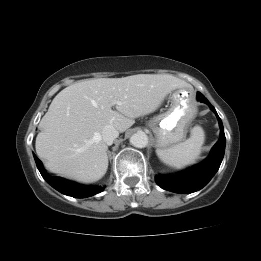
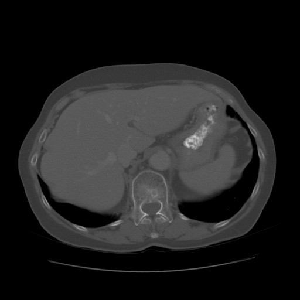

# Lab 4: from numbers to a picture

A CT image is not a picture. It is a grid of measurements, and a picture is one way of
looking at them. You will check that the archive kept every measurement while storing the
file in a quarter of the space, read the measurements in their physical unit, and see why
one slice gives many pictures.

- **Before you start:** the server holding the sample study, as at the end of
  [Lab 2](lab-archive.md) or [Lab 3](lab-network.md). From an empty server, send the three
  files as in the [quickstart](quickstart.md#3-send-it).
- **Read with it:** [DICOM: files and studies](dicom-files.md), the part on pixels and
  transfer syntaxes.

## 1. What the archive kept

Ask the server for the first slice exactly as it holds it, and compare sizes with the file
you sent:

```bash
curl -o stored.dcm http://127.0.0.1:8080/instances/518d98a6-f5a3181d-2984303f-271f3d0d-c973dfc2/file
ls -l 00001.dcm stored.dcm
```

`00001.dcm` is 525190 bytes and `stored.dcm` is 146666 bytes: 28 % of what you sent. Ask
pydicom what changed:

```bash
uvx pydicom show stored.dcm | grep -E "Transfer Syntax|Pixel Data"
```

```text
(0002,0010) Transfer Syntax UID                 UI: JPEG-LS Lossless Image Compression
(7FE0,0010) Pixel Data                          OB: Array of 145754 elements
```

The server compressed the pixels with JPEG-LS and changed the transfer syntax to say so.
The pixels went from 524288 bytes to 145754.

## 2. Is anything lost?

"Lossless" is a claim. Check it. Save this as `pixels.py`:

```python
import sys

import numpy as np
import pydicom

sent = pydicom.dcmread(sys.argv[1])
stored = pydicom.dcmread(sys.argv[2])
a, b = sent.pixel_array, stored.pixel_array
print("sent  ", sent.file_meta.TransferSyntaxUID.name, a.shape, a.dtype)
print("stored", stored.file_meta.TransferSyntaxUID.name, b.shape, b.dtype)
print("same pixels:", np.array_equal(a, b))
```

`pixel_array` decodes the pixels of a file into a grid of numbers, whatever its transfer
syntax. `pyjpegls` gives pydicom the JPEG-LS decoder:

```bash
uv run --with pydicom --with numpy --with pyjpegls python pixels.py 00001.dcm stored.dcm
```

```text
sent   Explicit VR Little Endian (512, 512) int16
stored JPEG-LS Lossless Image Compression (512, 512) int16
same pixels: True
```

All 262144 values are equal. You checked it with a decoder that pacs-rs does not use, which
is the only kind of check worth making: pacs-rs makes the same comparison with its own
decoder before it keeps a compressed copy.

**Question.** A photo saved as an ordinary JPEG also gets much smaller. Why is that kind of
compression not used here?

<details>
<summary>Answer</summary>

Ordinary JPEG is lossy: it changes pixel values a little, in ways an eye does not notice in
a photo. In a CT every value is a measurement. A radiologist may be judging a difference of a
few units between a lesion and the tissue around it, and research code computes on the
values directly. An archive must give back what the scanner measured, so pacs-rs compresses
only in ways that can be undone exactly, and checks that each time.

</details>

## 3. Ask for it the old way

Not every program can decode JPEG-LS. A client says which transfer syntax it wants, and the
server converts on the way out. Ask DICOMweb for the same instance in Explicit VR Little
Endian:

```bash
curl -o native.dcm \
  -H 'Accept: application/dicom; transfer-syntax=1.2.840.10008.1.2.1' \
  http://127.0.0.1:8080/dicom-web/studies/2.25.3100000/series/2.25.3200000/instances/2.25.3300001
cmp native.dcm 00001.dcm && echo identical
```

```text
identical
```

`cmp` compares two files byte by byte and is silent when they are equal. For this file, what
comes back is the file you sent, down to the last byte.

## 4. What the numbers mean

The values of a CT are in **Hounsfield units** (HU), a scale of how much a tissue stops
X-rays: water is 0 and air is −1000. Two elements of the file say how to get from a stored
value to HU:

```text
HU = stored value × Rescale Slope + Rescale Intercept
```

Add these lines to the end of `pixels.py` and run it again:

```python
hu = a * float(sent.RescaleSlope) + float(sent.RescaleIntercept)
print("HU from", hu.min(), "to", hu.max())
print("value at the centre:", hu[256, 256])
```

```text
HU from -3024.0 to 1002.0
value at the centre: 77.0
```

**Questions.**

1. The slope is 1 and the intercept 0 in this file. Why apply them anyway?
2. Air is −1000 HU and nothing stops fewer X-rays than air. What can −3024 be?

<details>
<summary>Answers</summary>

1. Because they are not 1 and 0 in general. Many scanners store unsigned values with an
   intercept of −1024. Code that skips the rescale works on this file and is wrong by a
   thousand units on the next hospital's. Always read the two elements.
2. It is not a measurement. A CT scanner reconstructs a circle, and the corners of the
   square image, outside that circle, are filled with a value that means "no data". Here it
   is −3024. Anything that averages a whole slice must leave those pixels out.

</details>

## 5. One slice, many pictures

The slice holds values from −3024 to 1002. A screen shows 256 shades of grey. A **window**
chooses which range of values is spread over those shades: a centre and a width, in HU.
Everything below the window is black and everything above it is white.

The server can do this for you. Ask for the slice as a picture, first in the window the file
proposes (centre 40, width 400, usual for the abdomen), then in a window for bone:

```bash
I=http://127.0.0.1:8080/dicom-web/studies/2.25.3100000/series/2.25.3200000/instances/2.25.3300001
curl -o abdomen.jpg "$I/rendered"
curl -o bone.jpg "$I/rendered?window=400,1800,linear"
```

Open the two files.

| Centre 40, width 400 | Centre 400, width 1800 |
|---|---|
|  |  |

Both pictures come from the same 262144 numbers. In the first, the liver, the spleen and the
vessels inside the liver can be told apart, and the vertebra is a white shape. In the
second, the organs are one flat grey and the inside of the vertebra shows.

**Questions.**

1. The abdominal window shows values from −160 to 240 HU. Where do those two numbers come
   from?
2. Try `window=-600,1500,linear`, a window for the lungs. This slice is at the top of the
   abdomen: what do you expect to see better?
3. A colleague sends you `abdomen.jpg` and asks you to measure the liver's density on it. Why
   can you not?

<details>
<summary>Answers</summary>

1. Centre ± half the width: 40 − 200 and 40 + 200.
2. The dark areas at the back, on both sides of the spine, are the bases of the lungs. The
   abdominal window paints all of them black; a lung window spreads the values around −600
   over the greys, so what is inside them can show.
3. The picture has 256 shades where the slice had thousands of values, and the window
   decided which values share a shade. The HU are gone. A rendered picture is for looking;
   measurements need the DICOM file. That is why a PACS serves both.

</details>

## What you learned

- A CT slice is a grid of measurements in Hounsfield units. The rescale elements turn stored
  values into HU.
- pacs-rs stores the slice compressed without changing one value, and gives it back in the
  transfer syntax a client asks for.
- A window turns measurements into a picture, and there is no single right one.
- A picture is not the data.

## Where next

- Open the study in the [web interface](web-interface.md) and change the window with the
  mouse.
- Write programs against the archive: [REST API, task by task](rest-guide.md).
- Prepare a dataset for research: [De-identification](de-identification.md).
