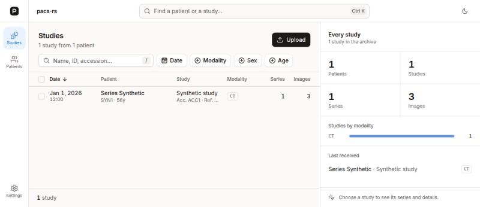

# Quickstart: your first study

In about five minutes you will have a PACS running on your machine, a real CT study stored in
it, and that study open in a viewer. You need Docker and `curl`, nothing else.

Along the way you will see how a study gets into a PACS, how the PACS files it under a
patient, and the two ways a program can ask for it back.

> [!NOTE]
> Every command shown after a `$` on this page is run against a real server each time the
> documentation changes, and its answer compared with the one printed here
> ([how](building.md#the-documentations-examples)). What you read is what you will get.

## 1. Start the server

```bash
curl -fsSLO https://raw.githubusercontent.com/Aegyptiacus11/pacs-rs/main/compose.yaml
docker compose up -d --wait
```

pacs-rs is now listening at `http://127.0.0.1:8080`. Only your own machine can reach it. What
you store is kept in a Docker volume named `pacs-data`, so it is still there after a restart.

## 2. Download a study

Any DICOM files you have will do. To get the same answers as this page, use the sample study:
three slices of an abdominal CT from a public research dataset ([LiTS](sample-study.md),
volume 0), about half a megabyte each.

```bash
for n in 1 2 3; do
  curl -fsSLO "https://aegyptiacus11.github.io/pacs-rs/sample/0000$n.dcm"
done
```

## 3. Send it

Send each file to `/instances`, one request per file:

```console
$ curl --data-binary @00001.dcm http://127.0.0.1:8080/instances
$ curl --data-binary @00002.dcm http://127.0.0.1:8080/instances
$ curl --data-binary @00003.dcm http://127.0.0.1:8080/instances
```

The server answers each file with where it filed it. For the last one:

```json
{
  "ID": "9cd16b73-7d0f8d85-241e9bbc-f9ddb0a0-afb3d988",
  "ParentPatient": "64c94bda-110c6fa1-720a3d46-248247e2-bdf1f055",
  "ParentSeries": "95204644-8052ee6c-ad3a3db9-22191e1f-3a6aeb05",
  "ParentStudy": "478cde9c-3f36815e-7253a722-f52d98c8-d15779eb",
  "Path": "/instances/9cd16b73-7d0f8d85-241e9bbc-f9ddb0a0-afb3d988",
  "Status": "Success"
}
```

Notice that you never said which patient or study these files belong to. Every DICOM file
carries that itself, and pacs-rs read it: the three files name the same series of the same
study, so the server now holds one patient, one study, one series and three instances.

You can also drag the files onto the web interface. It does the same thing: it sends each one
to `/instances`.

## 4. Look at it

Open <http://127.0.0.1:8080/ui/>. The study list has one line: the patient `LITS-0`, with a CT
study of one series and three images. Click it to open the [viewer](web-interface.md).



## 5. Ask for it from a program

A program has two ways in.

| | REST API | DICOMweb |
|---|---|---|
| Names things by | identifiers the server computes | the DICOM UIDs written in the files |
| Answers in | plain JSON | DICOM JSON |
| Made for | scripts and pipelines | viewers and other standard tools |

The [REST API](rest-guide.md) first. Ask for the studies, and you get their identifiers:

```console
$ curl http://127.0.0.1:8080/studies
```

```json
["478cde9c-3f36815e-7253a722-f52d98c8-d15779eb"]
```

Then [DICOMweb](dicomweb.md), the DICOM standard's own HTTP interface (PS3.18). Ask for the
series of the study by its UID, and each attribute comes back under its DICOM tag:

```console
$ curl -H 'Accept: application/dicom+json' http://127.0.0.1:8080/dicom-web/studies/2.25.3100000/series
```

```json
[
  {
    "00080020": {"vr": "DA", "Value": ["20261117"]},
    "00080030": {"vr": "TM", "Value": ["120000"]},
    "00080050": {"vr": "SH"},
    "00080090": {"vr": "PN"},
    "00081030": {"vr": "LO", "Value": ["Three slices of LiTS volume 0"]},
    "00100010": {"vr": "PN", "Value": [{"Alphabetic": "VOLUME 0^LITS"}]},
    "00100020": {"vr": "LO", "Value": ["LITS-0"]},
    "00100030": {"vr": "DA"},
    "00100040": {"vr": "CS"},
    "0020000D": {"vr": "UI", "Value": ["2.25.3100000"]},
    "00200010": {"vr": "SH", "Value": ["1"]},
    "00080060": {"vr": "CS", "Value": ["CT"]},
    "0008103E": {"vr": "LO", "Value": ["Axial 5 mm"]},
    "0020000E": {"vr": "UI", "Value": ["2.25.3200000"]},
    "00200011": {"vr": "IS", "Value": [1]},
    "00201209": {"vr": "IS", "Value": [3]},
    "00081190": {"vr": "UR", "Value": ["..."]},
    "00080005": {"vr": "CS", "Value": ["ISO_IR 192"]}
  }
]
```

On these pages `"..."` stands for a value that changes from one server to the next. Here it is
the address the series can be retrieved from.

## 6. Stop it

```bash
docker compose down        # the study is kept in the pacs-data volume
docker compose down -v     # the study is deleted with the volume
```

## Before real data

> [!CAUTION]
> Anyone who can reach this server can read and delete everything on it. The quickstart is
> safe only because the port is published on this machine alone. Before a real patient's study
> goes in, turn the [login](login.md) on.

## Where next

- New to DICOM? [DICOM: files and studies](dicom-files.md) opens the files you just sent and
  shows what is inside.
- Learn by doing? The [labs](labs.md) are four practical sessions on this same study.
- Have a dataset for research, or setting up for a clinic? [Two ways to use
  pacs-rs](two-ways.md) says what to read for each.
- Writing a script? [REST API, task by task](rest-guide.md) continues from step 5.
