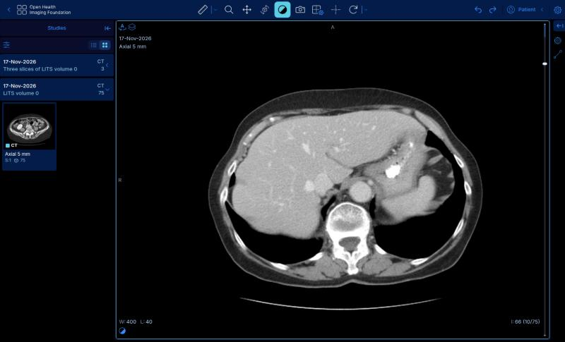

# Connecting another viewer

pacs-rs has a [viewer of its own](web-interface.md), and its studies are also there for any
viewer that speaks [DICOMweb](dicomweb.md). This page connects one, the
[OHIF Viewer](https://ohif.org/), step by step. Everything on it was done while the page was
written, with the image `ohif/app:latest` of 3 November 2026 and the server of the
[quickstart](quickstart.md); what was not tried is said at the end.



*The scan is volume 0 of LiTS, a public research dataset ([the sample study](sample-study.md)).*

## What a viewer needs from pacs-rs

| Need | Setting or address |
|---|---|
| The DICOMweb root | `http://<server>/dicom-web`, for searching (QIDO-RS) and for retrieving (WADO-RS) alike |
| Leave to call from another address | `PACS_CORS_ORIGINS`: the viewer's origin, as the browser's address bar shows it |
| With the [login](login.md) on, a token | `Authorization: Bearer <access token>` on every request |

A viewer in the browser, served from another address than pacs-rs, is stopped by the browser
unless pacs-rs names that address in `PACS_CORS_ORIGINS`. An origin is the scheme, the host
and the port, without a path: `http://127.0.0.1:3000`, not `http://127.0.0.1:3000/`.

## Without the login

Tell pacs-rs where the viewer will be. With the quickstart's `compose.yaml`, under
`environment`:

```yaml
      PACS_CORS_ORIGINS: http://127.0.0.1:3000
```

and `docker compose up -d --wait` again.

Then write the viewer's configuration, `app-config.js`:

```js
window.config = {
  routerBasename: null,
  extensions: [],
  modes: [],
  showStudyList: true,
  defaultDataSourceName: 'pacs-rs',
  dataSources: [
    {
      namespace: '@ohif/extension-default.dataSourcesModule.dicomweb',
      sourceName: 'pacs-rs',
      configuration: {
        friendlyName: 'pacs-rs',
        name: 'pacs-rs',
        qidoRoot: 'http://127.0.0.1:8080/dicom-web',
        wadoRoot: 'http://127.0.0.1:8080/dicom-web',
        wadoUriRoot: 'http://127.0.0.1:8080/dicom-web',
        qidoSupportsIncludeField: false,
        imageRendering: 'wadors',
        thumbnailRendering: 'wadors',
        enableStudyLazyLoad: true,
        supportsFuzzyMatching: false,
        supportsWildcard: true,
        staticWado: false,
        singlepart: 'bulkdata,video',
        omitQuotationForMultipartRequest: true,
      },
    },
  ],
};
```

and start the viewer with it:

```bash
docker run -d --name ohif -p 127.0.0.1:3000:80 -e APP_CONFIG="$(cat app-config.js)" ohif/app:latest
```

`http://127.0.0.1:3000/` now lists the studies of pacs-rs, and a study opens with its series
at the left. A study opens by its address too:
`http://127.0.0.1:3000/viewer?StudyInstanceUIDs=<Study Instance UID>`.

Why these values:

- **`thumbnailRendering: 'wadors'`**: pacs-rs has no thumbnail route (`.../thumbnail` answers
  404), so the viewer draws its thumbnails from the frames themselves.
- **`supportsFuzzyMatching: false`**: pacs-rs matches as asked and says so when a request
  wants fuzzy matching ([Searching](dicomweb.md#searching)).
- **`supportsWildcard: true`**: `*` and `?` are matched, so typing part of a name in the
  viewer's study list finds it.
- **`staticWado: false`**: pacs-rs answers requests; it is not a folder of files written
  ahead.

What the viewer asked of the server while a study of 75 images was opened and scrolled: the
study by its UID, its series, the studies of the same patient, the metadata of the series in
one request, and each frame once (`.../instances/<uid>/frames/1`). Frames come back as they
are stored, compressed without loss, and the viewer decodes them.

## With the login

With `PACS_AUTH=true` every request needs an access token, and the viewer without one shows
"Data Source Connection Error" (the server answered 401). pacs-rs does not yet sign people in
through a provider (OpenID Connect), which is how this viewer signs its users in; that is on
the [roadmap](roadmap.md). Until then one way works: hand the viewer an access token in its
address.

```text
http://127.0.0.1:3000/viewer?StudyInstanceUIDs=<Study Instance UID>&token=<access token>
```

The viewer takes the token out of the address at once and sends it as
`Authorization: Bearer` on every request to pacs-rs. The token is one a person gets from
`POST /auth/login`, or a [tool](login.md#tools) from `POST /auth/token`.

Know its limits before using it:

- **It runs out.** A person's access token lasts 15 minutes, a tool's 5, and the viewer
  cannot renew it: after that pacs-rs answers 401, and the study must be opened again with a
  new token.
- **It is the account's whole right.** The token reads everything its account may read, so
  give it the least role that does the work, and [projects](login.md#rights-per-project)
  where they apply.
- **An address is easy to leak.** The viewer removes the token from the address bar, but
  the web server that serves the viewer has already written the whole address in its log,
  token included. A link made by a program and opened at once is fine; a link sent by mail
  is not.

## When it does not work

| What the viewer shows | Likely cause |
|---|---|
| "Data Source Connection Error" at the study list | pacs-rs is not at the address in `qidoRoot`; or the login is on and there is no token; or the viewer's origin is not in `PACS_CORS_ORIGINS` (the browser's console then names CORS) |
| The study list works, images stay black, the console names CORS on a `/frames/` address | the browser kept those frames from a visit before `PACS_CORS_ORIGINS` was set; empty the browser's cache |
| Thumbnails missing | `thumbnailRendering` is not `'wadors'` |

## Not tried

- Serving the viewer and pacs-rs from one address behind a [reverse proxy](reverse-proxy.md),
  which needs no `PACS_CORS_ORIGINS`.
- Storing from the viewer (measurements as DICOM SR, segmentations) with STOW-RS.
- Other viewers. Any that takes a DICOMweb root should connect the same way; the options'
  names will differ.
